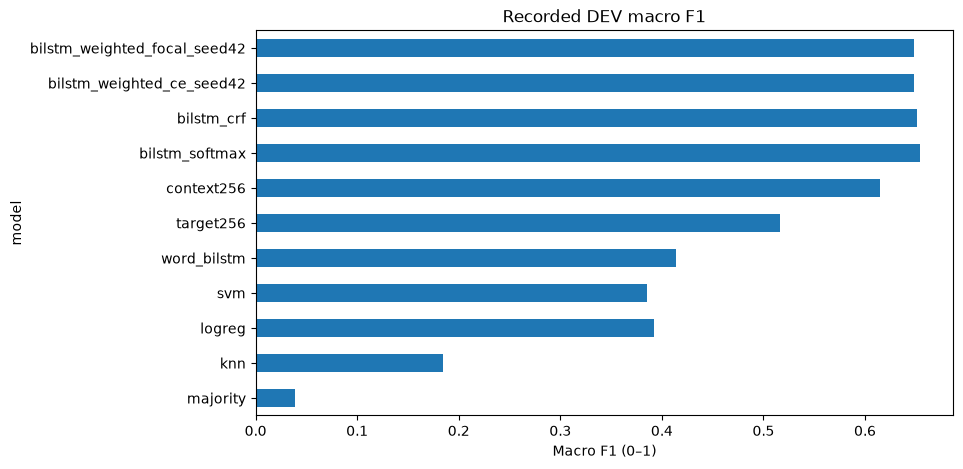
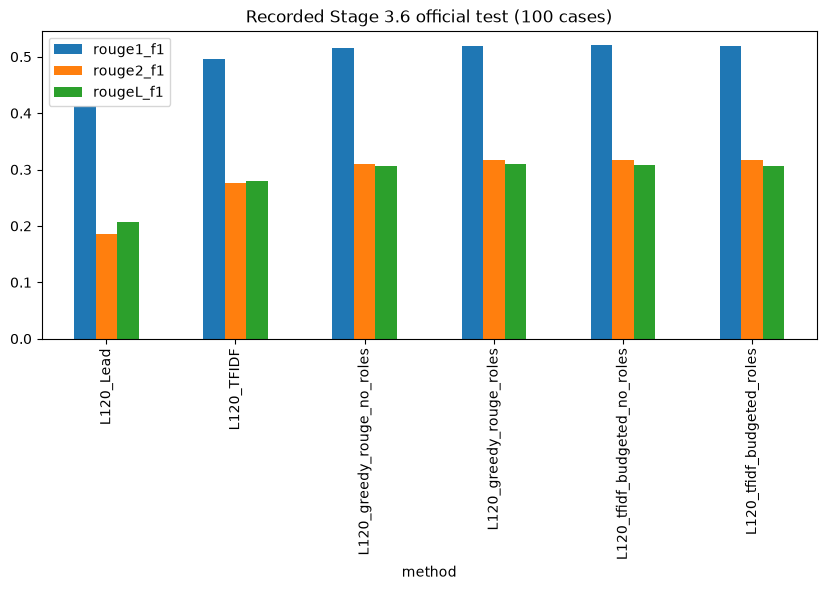

# Legal Judgment Summarizer

**Version 4.6.0 — review-assisted research app.** Improved final-decision attribution, qualification retention and recovery from an unclosed inline quotation in a structured PDF. **91 automated tests pass**, including evaluation checks. Trained weights are unchanged; no new unseen-document accuracy is claimed. [Changes, measured results and remaining errors](docs/decision_upgrade.md).

An English legal NLP mini project: **classical ML → InLegalBERT → document BiLSTM → extractive sentence selection → evidence-linked review app**.

The four notebooks explain the logic in short steps. Heavy training is optional; the default demonstration uses invented examples and clearly labeled recorded results. The existing trained model is preserved; the inference pipeline includes the documented 4.6 decision-extraction fixes.

**Want to see the early ML code in full?** Open [00_classical_ml_and_word_bilstm](notebooks/00_classical_ml_and_word_bilstm.ipynb) ([Colab](https://colab.research.google.com/github/Mananfrfr/legal-judgment-summarizer/blob/main/notebooks/00_classical_ml_and_word_bilstm.ipynb)). This optional fifth notebook shows TF-IDF, majority baseline, KNN, logistic regression, SVM, error analysis, saved-model prediction and word-level BiLSTM training step by step. [Why the other notebooks are short and where the full code lives](docs/code_map.md).

**Research preview:** the app requires human review. The original three-judgment check found two serious decision-section failures; their specified decision checks now pass after development fixes. Issue selection and reasoning omissions remain. Exact source matching is not legal accuracy. [Original evaluation](docs/current_pipeline_evaluation.md) · [4.6 follow-up](docs/decision_upgrade.md).

## Start here for the faculty presentation

Read the [faculty walkthrough and viva questions](docs/faculty_walkthrough.md), then open the notebooks in order:

| Notebook | What you explain | Open |
|---|---|---|
| [01_data_preprocessing](notebooks/01_data_preprocessing.ipynb) | Datasets, sentence roles, annotation audit, split leakage | [Colab](https://colab.research.google.com/github/Mananfrfr/legal-judgment-summarizer/blob/main/notebooks/01_data_preprocessing.ipynb) |
| [02_model_training](notebooks/02_model_training.ipynb) | TF-IDF, InLegalBERT, BiLSTM/CRF and weakly supervised selectors | [Colab](https://colab.research.google.com/github/Mananfrfr/legal-judgment-summarizer/blob/main/notebooks/02_model_training.ipynb) |
| [03_model_evaluation](notebooks/03_model_evaluation.ipynb) | Recorded comparisons, macro F1, ROUGE and error analysis | [Colab](https://colab.research.google.com/github/Mananfrfr/legal-judgment-summarizer/blob/main/notebooks/03_model_evaluation.ipynb) |
| [04_final_pipeline](notebooks/04_final_pipeline.ipynb) | New document → source evidence → structured brief → review | [Colab](https://colab.research.google.com/github/Mananfrfr/legal-judgment-summarizer/blob/main/notebooks/04_final_pipeline.ipynb) |

Each notebook has one setup cell. `%%project` runs ordinary Python in a persistent isolated kernel, keeping legacy Hugging Face dependencies out of Colab's base environment. All five default paths were executed locally through this mechanism; a fresh hosted Colab installation and full retraining were not run during consolidation. The first hosted setup can take several minutes.

## Current summarization measurement

The current 4.6.0 pipeline was run on **all 100 official IN-Abs test judgments** at the app's default 800-word target:

| ROUGE-1 F1 | ROUGE-2 F1 | ROUGE-L F1 (95% interval) |
|---:|---:|---:|
| 37.42 | 18.25 | 20.94 (19.41–22.58) |

Scores are on a 0–100 scale; they are **not summary-correctness percentages**. The current structured pipeline scores below the opening-sentence baseline on ROUGE-L. These results do not establish a reference-overlap improvement from the pipeline. The decision fixes addressed specific attribution errors; they did not establish better overall summarization. The test set was previously used in Stage 3.6, so this is a reused benchmark. [Full baseline comparison, confidence intervals and limitations](docs/current_summary_benchmark.md).

The default briefs averaged 308 words despite an 800-word target, and 47/100 had an empty decision section. These coverage limitations remain even though exact-source checks pass.

## What the recorded experiments show

| Experiment | Split | Macro F1 | Weighted F1 |
|---|---|---:|---:|
| TF-IDF + logistic regression | DEV | .3921 | .4806 |
| Stage 1 word BiLSTM | DEV | .4135 | .5082 |
| Target-only InLegalBERT, 256 tokens | DEV | .5166 | .6704 |
| Context-aware InLegalBERT | DEV | .6149 | .7569 |
| Frozen encoder + document BiLSTM | DEV | .6541 | .8237 |
| Frozen encoder + document BiLSTM + CRF | DEV | .6516 | .8239 |

The best recorded role-classifier DEV accuracy is **83.12%**, with macro F1 **65.41%**. This measures sentence-role classification, not whole-summary correctness. These are saved experiment results, not fresh reruns. [Full role table](evaluation/role_results.csv).



The earlier Stage 3.6 official test evaluated six methods on 100 IN-Abs cases, using 120 sampled candidates and a 400-word budget. The TF-IDF-teacher no-role selector recorded ROUGE-1/2/L F1 of **.5202 / .3177 / .3073**; the greedy-teacher role-aware selector recorded **.5188 / .3168 / .3096**. No single condition wins every metric. [All methods](evaluation/evaluation_results.csv), [recorded provenance](evaluation/recorded/provenance.json).



The current app uses full-document windows and structured evidence rules, so those older ROUGE scores do not measure its current performance. Three previously inspected cases and four additional source-reviewed judgments have separate decision-coverage reports; all are now development cases. No general human legal-accuracy percentage is claimed.

## Run locally

Python 3.11 is the locally tested version. Create an isolated environment:

```bash
python -m venv .venv
# Windows: .venv\Scripts\activate
# macOS/Linux: source .venv/bin/activate
python -m pip install torch==2.14.1 --index-url https://download.pytorch.org/whl/cpu
python -m pip install -r requirements-app.txt -r requirements-training.txt
python -m pip check
python scripts/download_models.py
python src/stage44_app.py
```

On Windows, after setup you can also run `powershell -ExecutionPolicy Bypass -File .\Start-App.ps1`. The launcher checks model paths and reuses this project's existing local environment when available.

Open **http://127.0.0.1:7861** on the same computer. Keep the terminal running. The app loads `models/encoder` and `models/stage4_english_model_bundle.zip` by default; alternatively set `LEGAL_ENCODER_DIR` and `LEGAL_MODEL_BUNDLE`. Install Tesseract separately if you need OCR. Use native-text mode for searchable PDFs.

Model weights are provided as versioned GitHub Release assets with SHA-256 verification, rather than committed into Git history. The existing trained weights are unchanged. See [model provenance](models/README.md).

For notebook execution in an already prepared environment, set `PROJECT_PYTHON` to that environment's Python. Otherwise notebook setup creates its own environment. The Colab path uses Torch 2.8.0/cu128; local checks used Torch 2.14.1+cpu. Numerical equivalence across runtimes has not been established.

## Data and reproduction

Follow [data/README.md](data/README.md) to obtain the original datasets. The public repository includes downloaders, access instructions, checksums, annotation policy and fixed split IDs. It does not mirror the gated corpus or publish private uploads. `HF_TOKEN` is only needed for authorized role-dataset access, never for the app or the synthetic demo.

Set `DEMO=False` in Notebook 01 to prepare official data. Notebook 02 defaults to `RUN_TRAINING=False`; opt in to long GPU training when ready. Newly trained encoder/head/selector outputs remain research experiments until re-evaluated and packaged with matching provenance. Do not combine a new encoder with the old selector bundle. Archived source exports preserve the original experiments for comparison; the concise workflow does not claim a fresh numerical reproduction.

```text
notebooks/    four main notebooks + optional detailed Stage 1 ML notebook
src/          audited pipeline, readable training entrypoints, review app
tests/        inference, app, CRF and teaching-workflow checks
data/         dataset instructions, source URLs, fixed train/dev IDs
models/       model provenance and release checksums/download links
evaluation/   recorded metrics, manifests and current failure review
examples/     invented judgment and a sample evidence-only summary
docs/         architecture, methodology, faculty guide, validation
research/     original notebook code exports for provenance (not the main workflow)
scripts/      dataset/model downloaders, notebook builder and validation
```

## Validate

```bash
python -m pip install -r requirements-test.txt
python -m unittest discover -s tests -v
python scripts/validate_notebooks.py
# Also exercise one synthetic epoch of the optional word BiLSTM:
python scripts/validate_notebooks.py --word-bilstm-smoke
```

**91 automated tests passed** after adding the current-summary evaluation (86 for the decision upgrade; 71 at original consolidation). All five default demonstration notebooks and a one-epoch synthetic word-BiLSTM training check were executed. Full official-data retraining, fresh hosted Colab installation and public app hosting are not claimed. See [validation](docs/validation.md).

## References and license

Original project code and documentation use the MIT License. Dataset, pretrained-model and dependency terms remain separate: see [third-party notices](THIRD_PARTY_NOTICES.md). [Architecture](docs/architecture.md) · [Methodology](docs/methodology.md) · [Source inventory](docs/source_inventory.json).
