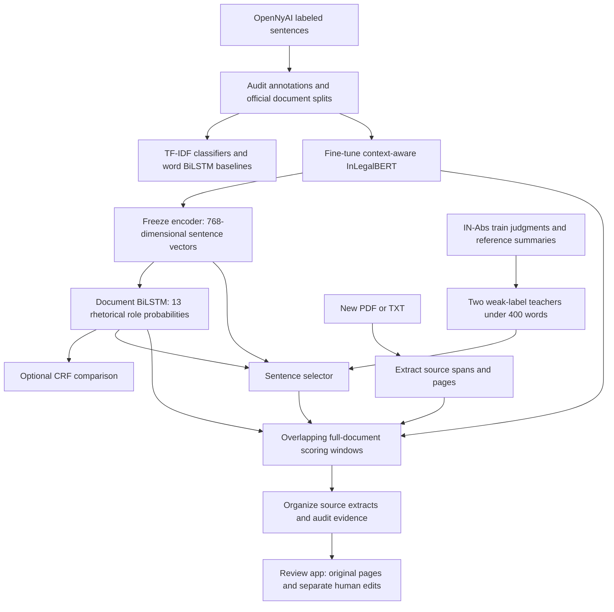

# Architecture

The role-feature input to the selector is optional. Inference does not use a reference summary. The current app uses the frozen softmax BiLSTM role head and two compatible selector checkpoints; it does not use CRF decoding. Handwritten attribution and evidence rules remain part of the final pipeline.

## What each component receives and returns

| Component | Input | Output | Why it exists |
|---|---|---|---|
| Annotation parser | Document annotations and offsets | Ordered labeled sentence rows | Avoid duplicated/conflicting examples and split leakage |
| TF-IDF | Sentence words | Sparse vector | Cheap classical baseline |
| Context encoder | Target plus adjacent same-document text, at most 256 tokens | 768-dimensional sentence representation | Use pretrained legal language and nearby context |
| Document BiLSTM | Ordered sentence vectors | 13 role logits/probabilities per sentence | Distinguish facts, arguments, reasoning and rulings in sequence |
| Selector | 768 features + position, optionally 13 role probabilities | One importance score | Learn which sentences are worth including |
| Full-document windows | All extracted sentences | Aggregated scores over 120-sentence windows, overlap 30 | Avoid losing the end of long judgments |
| Brief/evidence engine | Source spans, scores and heuristic attribution | Four sections, exact evidence and warnings | Keep extracts traceable and expose some failures |
| Review interface | Brief and original PDF | Human-reviewed draft and export | Let a reviewer correct omissions and wrong attribution |

The earlier benchmark sampled 120 candidates once. The current app slides across the complete extracted document. This distinction is essential when discussing results.
